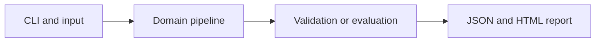

# Interpretable Nonlinear Regression

Train a depth-limited regression tree on nonlinear synthetic demand and inspect the learned rules.

**Category:** ML

**Execution:** Actual local algorithm or workflow; no external model service required.

## Run

```sh
python -m venv .venv
# Windows: .venv\Scripts\activate
# macOS/Linux: source .venv/bin/activate
python -m pip install -r requirements.txt
python app.py
python -m unittest discover -v
```

Open `results/report.html` after running. Python 3.10+ is required. Use `--help` for input and seed options.

## Architecture



## Algorithm

At every node search feature thresholds at empirical quantiles and minimize total squared error. Stop at maximum depth, small node size or insufficient gain. Leaf predictions are training means.

## Evaluation

Choose depth 2, 4 or 6 using a separate validation split; report held-out RMSE against a training-mean baseline. Inputs and targets are generated from a nonlinear process with noise.

## Limitations

Quantile candidates approximate exhaustive CART. Small synthetic data cannot establish production forecasting performance; random splits assume independent rows.

## Documentation

- [PDF project guide](PROJECT_GUIDE.pdf)
- [Editable guide](GUIDE.md)
- [Model and system card](MODEL_CARD.md)
- [Measured results](results/metrics.json)
- [Test output](TEST_RESULTS.txt)

## Extend it

Replace the generator with licensed tabular data; compare a linear model and random forest, add missing-value handling, and evaluate subgroup errors.

AI-assisted educational project with synthetic data. Review, customize and explain your own contribution accurately. MIT license.
